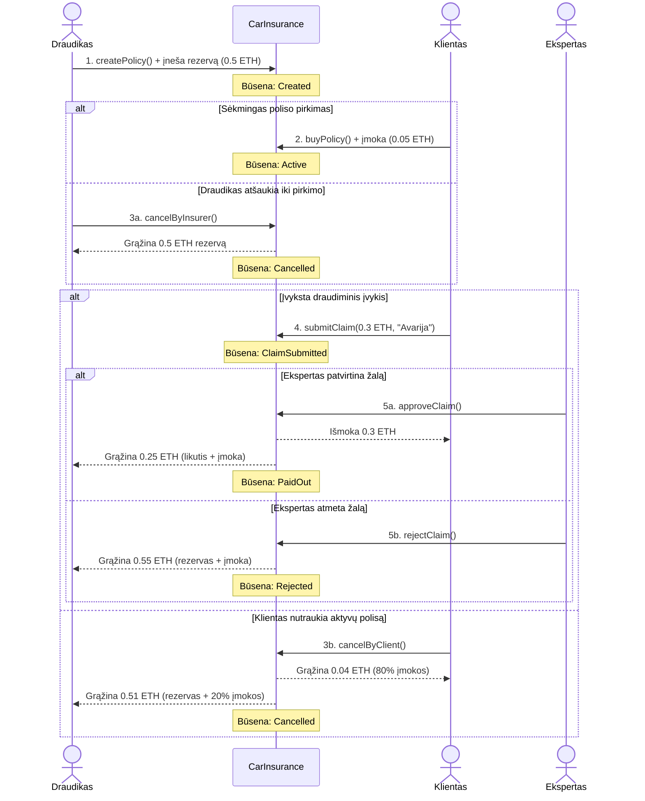

# Blockchain_LD4

## Sprendžiama problema

Tradiciniame automobilio draudime klientas privalo pasitikėti draudimo bendrove, kad įvykus draudiminiam įvykiui įmonė turės
pakankamai pinigų ir išmokės žalos atlyginimą, o bendrovė rizikuoja susidurti su nepagrįstomis ar suklastotomis pretenzijomis.
Ši išmanioji sutartis (_CarInsurance_) išsprendžia abipusio pasitikėjimo problemą: ji laikinai užšaldo draudiko išmokos rezervą ir kliento draudimo įmoką blokų grandinėje. Sukauptos lėšos paskirstomos automatiškai pagal iš anksto sutartyje užfiksuotas taisykles tik tada, kai nepriklausomas žalų ekspertas patvirtina įvykį ir žalos dydį.

## Dalyviai

Procese dalyvauja trys skirtingos šalys (demonstruojamos skirtingomis Ethereum paskyromis):

1. **Draudikas (Insurer)** – draudimo paslaugos teikėjas, formuojantis polisą ir garantuojantis išmokos rezervą.
2. **Klientas (Client)** – automobilio savininkas, įsigyjantis draudimo polisą ir galintis registruoti patirtą žalą.
3. **Žalų ekspertas (Assessor)** – nepriklausomas vertintojas (pvz., autoservisas arba nepriklausomas ekspertas), vertinantis įvykio pagrįstumą.

## Dalyvių teisės

- **Draudikas (Insurer):**
  - Turi teisę sukurti naują draudimo polisą, nurodydamas automobilio duomenis, įmokos kainą, kliento bei eksperto adresus, ir įnešti maksimalios išmokos rezervą.
  - Turi teisę atšaukti dar kliento nenupirktą polisą (`Created` būsenoje) ir susigrąžinti visą įneštą rezervą.
  - Negali vienašališkai atsiimti lėšų po to, kai klientas aktyvuoja polisą, ir negali pats vertinti pretenzijų.
- **Klientas (Client):**
  - Turi teisę nupirkti jam skirtą polisą, pervesdamas tikslią draudimo įmokos sumą.
  - Turi teisę nutraukti aktyvų polisą (`Active` būsenoje) iki draudiminio įvykio ir susigrąžinti 80 % įmokos.
  - Turi teisę užregistruoti draudiminį įvykį (pateikti pretenziją) galiojančiam polisui.
  - Negali pats patvirtinti savo žalos ir negali reikalauti didesnės išmokos nei maksimali poliso suma.
- **Žalų ekspertas (Assessor):**
  - Turi išskirtinę teisę patvirtinti arba atmesti kliento pateiktą pretenziją (`ClaimSubmitted` būsenoje).
  - Negali būti tas pats asmuo kaip draudikas ar klientas, taip pat negali keisti poliso sumų ar atsiimti sutartyje esančių lėšų.

## Pagrindiniai scenarijai

Polisas sistemoje gali pereiti per 6 būsenas: `Created` (Sukurta), `Active` (Aktyvi), `ClaimSubmitted` (Pateikta pretenzija), `PaidOut` (Išmokėta), `Rejected` (Atmesta), `Cancelled` (Atšaukta).

1. **Sėkminga draudimo ir žalos išmokėjimo eiga:**
   - Draudikas sukuria polisą ir įneša rezervą (pvz., `0.5 ETH`) $\rightarrow$ būsena `Created`.
   - Klientas nusiperka polisą sumokėdamas įmoką (pvz., `0.05 ETH`) $\rightarrow$ būsena `Active`.
   - Įvykus avarijai, klientas užregistruoja žalą (pvz., `0.3 ETH`) $\rightarrow$ būsena `ClaimSubmitted`.
   - Žalų ekspertas patvirtina pretenziją $\rightarrow$ klientui išmokama `0.3 ETH`, draudikui grąžinamas rezervo likutis ir įmoka (`0.25 ETH`), polisas užbaigiamas būsenoje `PaidOut`.
2. **Pretenzijos atmetimo scenarijus:**
   - Klientui pateikus pretenziją (`ClaimSubmitted`), ekspertas nustato, kad įvykis nedraudiminis, ir pretenziją atmeta.
   - Visas rezervas ir kliento įmoka (`0.55 ETH`) grąžinami draudikui, polisas užbaigiamas būsenoje `Rejected`.
3. **Poliso atšaukimo (nesėkmės) scenarijai:**
   - _Iki pirkimo:_ Draudikas atšaukia dar nenupirktą polisą (`Created`) ir susigrąžina 100 % savo rezervo (`Cancelled`).
   - _Po pirkimo (iki įvykio):_ Klientas nutraukia aktyvų polisą (`Active`) – jam grąžinama 80 % įmokos (`0.04 ETH`), o draudikui grąžinamas rezervas ir 20 % administravimo mokestis (`0.51 ETH`), būsena tampa `Cancelled`.

## Proceso taisyklės

- **Role pagrįsta prieiga:** Kiekvieną būseną keičiančią funkciją gali iškviesti tik konkrečiam polisui priskirtas dalyvio adresas (`insurer`, `client` arba `assessor`).
- **Dalyvių atskyrimas:** Draudiko, kliento ir eksperto adresai privalo būti trys skirtingi, nenuliniai (`address(0)`) adresai.
- **Griežta veiksmų seka:** Veiksmai leidžiami tik atitinkamoje būsenoje (pvz., negalima pateikti pretenzijos neapmokėtam polisui arba atšaukti poliso jau pateikus pretenziją).
- **Tiksli lėšų apskaita (`wei` vienetais):**
  - Kurdamas polisą draudikas privalo įnešti rezervą, didesnį už įmoką (`msg.value > premium`).
  - Pirkdamas polisą klientas privalo sumokėti lygiai tokią sumą, kokia nurodyta polise (`msg.value == premium`).
  - Prašoma žalos suma turi būti didesnė už `0` ir neviršyti maksimalios išmokos (`0 < claimAmount <= maxCoverage`).
- **Apsauga nuo pakartotinio išmokėjimo:** Pasiekus galutinę būseną (`PaidOut`, `Rejected` arba `Cancelled`), polisas užrakinamas ir joks pakartotinis lėšų išmokėjimas ar būsenos keitimas yra neįmanomas.

## Dalyvių sąveika pateikiama sekų diagrama

**Trumpas diagramos veiksmų paaiškinimas:**

- **1 veiksmas (`createPolicy`):** Draudikas sukuria polisą ir į sutartį perveda maksimalios išmokos rezervą.
- **2 veiksmas (`buyPolicy`):** Klientas aktyvuoja draudimą, sumokėdamas polise nustatytą įmoką.
- **3a / 3b veiksmai (`cancelByInsurer` / `cancelByClient`):** Alternatyvios atšaukimo eigos – draudikas gali atšaukti dar nenupirktą polisą, o klientas gali nutraukti aktyvų polisą su 20 % bauda.
- **4 veiksmas (`submitClaim`):** Klientas užregistruoja draudiminį įvykį, nurodydamas remonto sumą ir aprašymą.
- **5a / 5b veiksmai (`approveClaim` / `rejectClaim`):** Ekspertas užbaigia procesą – patvirtinus žalą, sutartis padalina lėšas tarp kliento ir draudiko, o atmetus – visas lėšas grąžina draudikui.

## Ką užtikrina sutartis, kokios prielaidos/apribojimai lieka

- **Ką užtikrina sutartis:**
  - Užtikrina, kad lėšos tikrai yra rezervuotos sutartyje dar prieš klientui perkant polisą.
  - Užtikrina, kad nei draudikas, nei klientas negali vienašališkai pasisavinti svetimų lėšų.
  - Garantuojamas deterministinis lėšų paskirstymas pagal eksperto sprendimą ir apsauga nuo pakartotinio išmokėjimo.
  - Visi esminiai būsenos pokyčiai užfiksuojami blokų grandinės įvykiais (_events_).
- **Prielaidos ir apribojimai:**
  - **Išorinio pasaulio faktų tikrinimas (Orakulo riba):** Išmanioji sutartis pati negali patikrinti, ar tikrai įvyko avarija ir kokia yra reali remonto kaina, todėl remiasi prielaida, kad **Žalų ekspertas** yra sąžiningas. Jei ekspertas ir klientas susitartų, jie galėtų neteisėtai pasisavinti draudiko rezervą.
  - **Duomenų viešumas:** Visi blokų grandinėje įrašyti duomenys (adresai, sumos, įvykio aprašymas) yra viešai matomi, todėl jautrūs asmens duomenys ar avarijos nuotraukos turėtų būti saugomi už grandinės ribų (_off-chain_).
  - **Dalyvių neaktyvumas:** Jei klientas nenusiperka sukurto poliso, draudikas gali atgauti lėšas per `cancelByInsurer`. Tačiau jei klientas pateikė pretenziją, o ekspertas delsia priimti sprendimą, šioje versijoje lėšos lieka užšaldytos sutartyje iki sprendimo priėmimo (ateityje tai būtų galima spręsti įvedant laiko terminus per `block.timestamp`).
